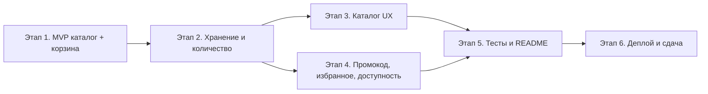

# spec.md — план разработки магазина по этапам (без backend)

План разбивает [ТЗ](README.md) на этапы. Каждый этап делается независимо, имеет понятный результат и **сценарий проверки**, который можно показать ментору или на демо. Вариант — чистая статика: HTML/CSS/JS в `site/`, без серверного кода. Backend из ТЗ (B1–B6) отложен, но план по нему сохранён в конце как резерв.

---

## 0. Общие решения (зафиксировать до старта)

| Решение | Значение | Комментарий |
|---|---|---|
| Тема магазина | например: космическая еда / настольные игры | Влияет только на данные, не на код |
| Товары | 4–6 штук, вымышленные, целые цены в рублях | Больше товаров — легче проверять фильтры и сортировку |
| Повторное добавление | отдельной строкой | Проще проверять сумму; вариант «не добавлять второй раз» тоже допустим |
| Ключ `localStorage` | `teamNN:cart:v1`, `teamNN:fav:v1` | NN — номер команды, обязателен по ТЗ |
| Стек | только статика: `site/` (HTML/CSS/JS) | Backend (B1–B6) не делаем; см. резерв в конце |
| Репозиторий | публичный, ветка `main`, фичевые ветки/PR | Нужен для D2 |

**Ответственность за этап:** один человек = один этап, чтобы принимать результат по отдельности.

---

## Схема этапов

Этапы **3 и 4 можно делать параллельно**: они не зависят друг от друга и опираются только на результат этапа 2.

---

## Этап 1. Обязательный минимум (MVP)

**Цель:** закрыть 4 обязательные функции ТЗ на чистой статике.

**Что делаем:**
- `site/index.html` — разметка: блок «Каталог», блок «Корзина», итог.
- `site/app.js` — массив товаров в коде: `{ id, name, price, category }`, минимум 3 товара.
- Рендер каталога: название, цена в рублях, кнопка «Добавить».
- Список корзины: добавление, удаление строки.
- Общая сумма: пересчёт при добавлении и удалении, в пустой корзине — `0 ₽`.
- `site/styles.css` — простое, но читаемое оформление: названия, цены и кнопки понятны.

**Как проверить (сценарий из ТЗ):**
1. Открыть страницу — видны ≥3 товара с ценами.
2. Добавить товар за 100 ₽ и товар за 200 ₽ → итог **300 ₽**.
3. Удалить первый → итог **200 ₽**.
4. Удалить второй → корзина пуста, итог **0 ₽**.

**Результат этапа:** работает и через `go run .` (http://localhost:8000, сервер просто раздаёт статику), и как чистая статика (Live Server / Python http.server) — это основа ZIP-версии для сдачи.

---

## Этап 2. Сохранение корзины и количество (F2, F3)

**Цель:** корзина не теряется и удобно редактируется.

**Что делаем:**
- Сохранение корзины в `localStorage` под ключом `teamNN:cart:v1`; восстановление при загрузке.
- Изменение количества (кнопки +/− или поле) с пересчётом суммы.
- Валидация при чтении из хранилища: битые данные → корзина пустая, а не сломанная страница.

**Как проверить:**
1. Добавить 2 × товар за 100 ₽ → итог **200 ₽**; перезагрузить страницу — корзина и сумма сохранились.
2. Убавить количество до 0 → строка исчезает, пересчёт корректный.
3. Вручную испортить ключ в DevTools → страница загружается, корзина пустая, сумма 0 ₽.

---

## Этап 3. Каталог UX (F1, F4, F5, F6)

**Цель:** по каталогу удобно искать и выбирать.

**Что делаем:**
- **F1:** картинки товаров (`site/assets/`), подписи, заглушка при ошибке загрузки (`onerror`).
- **F4:** поиск по названию (регистронезависимый, по подстроке).
- **F5:** категории + фильтр с кнопкой «Сбросить».
- **F6:** сортировка по цене: по возрастанию / убыванию / без сортировки.
- Поиск, фильтр и сортировка применяются вместе (комбинируются).

**Как проверить:**
1. Сломать ссылку на картинку → вместо неё заглушка, товар остался.
2. Ввести часть названия → остались только совпавшие товары.
3. Выбрать категорию → только её товары; «Сбросить» → снова все.
4. Сортировка по цене меняет порядок; при поиске сортировка работает внутри найденного.
5. Сумма корзины не меняется от фильтров — корзина живёт отдельно.

---

## Этап 4. Промокод, избранное, доступность, мобильная версия (F7, F8, F10, F9)

**Цель:** фишки для финального демо. Можно делать по одной и показывать частями.

**Что делаем:**
- **F7:** промокод на скидку 10%: `300 ₽ → 270 ₽`. Скидка не накапливается при повторном применении и снимается при изменении корзины/сбросе кода.
- **F8:** «В избранное» у товара, отдельный просмотр избранного, сохранение в `teamNN:fav:v1`.
- **F10:** весь обязательный сценарий с клавиатуры: Tab доходит до кнопок, Enter добавляет/удаляет, есть видимый фокус.
- **F9:** вёрстка не разваливается на телефоне: колонки складываются, кнопки достаточно крупные.

**Как проверить:**
1. Корзина на 300 ₽ + промокод → **270 ₽**; ввести код второй раз → всё ещё **270 ₽**.
2. Добавить 2 товара в избранное, открыть его отдельно → только эти 2; после перезагрузки избранное сохранилось.
3. Пройти «добавить 2 товара, удалить 1» только с клавиатуры.
4. Открыть сайт в мобильном размере (DevTools 375px) — всё читается и нажимается.

---

## Этап 5. Качество: тесты и README (Q1, Q2)

**Цель:** воспроизводимый запуск и автоматическая проверка функций магазина.

**Что делаем:**
- **Q1:** автотесты обязательного сценария (добавить 100+200 → 300 → удалить → 200 → 0) и ключевых функций (поиск, фильтр, промокод). Тесты UI можно сделать на Playwright/Selenium или расширить существующий `tests/smoke.py`.
- **Q2:** README переписать под проект: тема, версии инструментов, способы запуска (`go run .`, Live Server, Python http.server), команда упаковки ZIP.
- Для каждой реализованной функции — короткий сценарий проверки (собрать из таблиц выше) в `README.md` или отдельном файле.

**Как проверить:**
1. На чистой машине по README (без подсказок) запускается сайт и/или тесты.
2. Тесты проходят зелёным и действительно проверяют функции магазина.

---

## Этап 6. Деплой и сдача (D1, D2)

**Цель:** публичная ссылка и пакет для сдачи.

**Что делаем:**
- **D1:** публикация `site/` на GitHub Pages по HTTPS (инструкция в README шаблона, раздел 5).
- **D2:** автообновление при push в `main` — включить `push` в `on` у `.github/workflows/pages.yml`, проверить по изменению текста.
- ZIP обязательного минимума: `go run . --pack` → `shop.zip`; распаковать и проверить без API.
- Краткий список реализованных функций + сценарии проверки; issue по форме сдачи.

**Как проверить:**
1. Публичная HTTPS-ссылка открывает магазин; обязательный сценарий проходит.
2. Push мелкого изменения в `main` → через несколько минут оно видно на сайте.
3. ZIP распакован в новую папку → магазин работает без сервера.

---

## Трассировка: функции ТЗ → этапы

| ID ТЗ | Функция | Этап |
|---|---|---|
| Обязательный минимум | Каталог, корзина, удаление, сумма | 1 |
| F2 | Количество в корзине | 2 |
| F3 | Сохранение корзины (`localStorage`) | 2 |
| F1 | Картинки с заглушкой | 3 |
| F4 | Поиск по названию | 3 |
| F5 | Категории и фильтр | 3 |
| F6 | Сортировка по цене | 3 |
| F7 | Промокод 10% | 4 |
| F8 | Избранное | 4 |
| F10 | Клавиатурная доступность | 4 |
| F9 | Мобильная версия | 4 |
| Q1 | Автотесты | 5 |
| Q2 | Воспроизводимый README | 5 |
| D1 | Публичный HTTPS-сайт | 6 |
| D2 | Автодеплой из `main` | 6 |
| B1–B6 | Backend (API, заказы, БД, остатки, токен) | отложено, см. ниже |

---

## Резерв: backend (если останется время и желание)

По ТЗ backend — дополнительный блок, его отсутствие не влияет на обязательный минимум. Если решите вернуться, порядок такой (по исходному плану):

1. **B1:** `GET /api/products` на Go, страница грузит каталог из API с фолбэком на локальный список.
2. **B2/B3:** серверный поиск/фильтр и `POST /api/orders` с валидацией и расчётом суммы на сервере.
3. **B4/B5/B6:** SQLite, остатки с защитой от конкурентных продаж, админ-токен через env.

Важно: GitHub Pages backend не запускает — для демо нужна либо статическая версия (уже будет готова на этапе 1), либо локальный запуск сервера.

---

## Рекомендуемый порядок

1. **Этап 1 — обязательно всем.** После него уже можно показывать работающий магазин.
2. **Этап 2** — следующий по ценности (маленький, сильно улучшает проверяемость).
3. **Этапы 3 и 4** — параллельно разными участниками; внутри каждого делайте по одной функции и сразу показывайте.
4. **Этап 5** — тесты писать на готовые функции, а не всё в конце.
5. **Этап 6** — после того как зафиксирован список функций для демо.

Правило по ТЗ: лучше меньше функций, но каждая показана работающей со сценарием проверки, чем много недоделанных.
